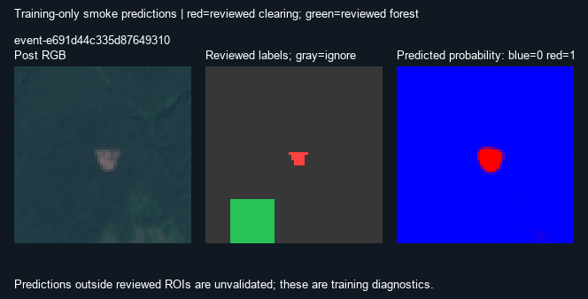

# Single-example overfit diagnostic

**Training memorization diagnostic only; no held-out score or timing inference.**

Arm: `local_weight_sgd`; event `event-e691d44c335d87649310`.
Completed 512 fixed attempts. Final reviewed-ROI fit gate: **True**.
Support: 25 clearing, 256 forest, 3815 ignored pixels.

Actual prediction preview:

Gray labels are ignored. Predictions outside reviewed ROIs remain unvalidated.

| Attempt | Weighted BCE | Normalized BCE | Dice | Precision | Recall | Ranking AUC | Fit |
| ---: | ---: | ---: | ---: | ---: | ---: | ---: | --- |
| 0 | 1.263802 | 0.693610 | 0.163399 | 0.088968 | 1.000000 | 0.971406 | False |
| 26 | 1.197290 | 0.657106 | 0.163399 | 0.088968 | 1.000000 | 1.000000 | False |
| 128 | 0.010341 | 0.005675 | 1.000000 | 1.000000 | 1.000000 | 1.000000 | True |
| 256 | 0.002988 | 0.001640 | 1.000000 | 1.000000 | 1.000000 | 1.000000 | True |
| 512 | 0.001092 | 0.000600 | 1.000000 | 1.000000 | 1.000000 | 1.000000 | True |

The primary fit decision uses the final attempt, never the best checkpoint. A completed fit=False result is retained as evidence.
Global/local weighted losses have different scales; normalized BCE divides by mean class-weight mass. This does not make their objectives identical.
Checkpoints and threshold 0.5 were fixed before execution. The adjacent metadata records actual resources, source hashes and stationary-step counts.

