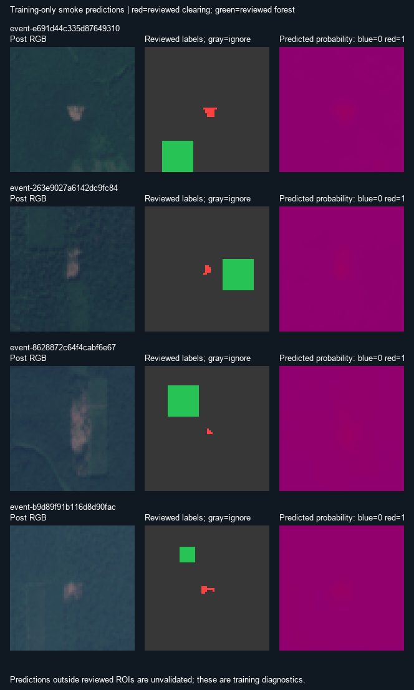

# CPU pilot baseline smoke check

**Passed** 26 tiny-model updates on 13 reviewed training examples.
All-ignored input skipped forward and optimizer execution. Saved weights exactly reproduced the final predictions. Dataset hashes/counts stayed unchanged.

**These are training diagnostics. They are not independent accuracy or first-visible-date predictions.**

| Diagnostic | Initial | Final |
| --- | ---: | ---: |
| weighted_bce | 1.312841 | 1.273797 |
| unweighted_bce | 0.746825 | 0.815136 |
| tp | 151 | 151 |
| fp | 2640 | 2640 |
| fn | 0 | 0 |
| tn | 0 | 0 |
| precision | 0.054102 | 0.054102 |
| recall | 1.0 | 1.0 |
| dice | 0.102651 | 0.102651 |
| iou | 0.054102 | 0.054102 |
| accuracy | 0.054102 | 0.054102 |
| balanced_accuracy | 0.5 | 0.5 |

Reviewed support: 151 positive, 2640 stable, 50457 ignored pixels.
An all-negative prediction already has 94.59% reviewed-pixel accuracy; accuracy alone is misleading.

The displayed probability images come from this tiny trained model. Gray supervision pixels are ignored; probabilities there are unvalidated.

One CPU worker, native/Torch threads one, batch size one, no data-worker processes or GPU. The adjacent metadata records the measured guard resources.

At threshold 0.5 this short smoke model predicts every reviewed pixel as clearing. It passes the pipeline checks but has not learned useful discrimination.

Runtime PyTorch: 2.6.0.dev20241112 (git 555bc8349d67a8f5ccd5325d1a7f46c3619b1769); installed distribution metadata: 2.5.1. The runtime identity is retained because these differ in the current environment.
