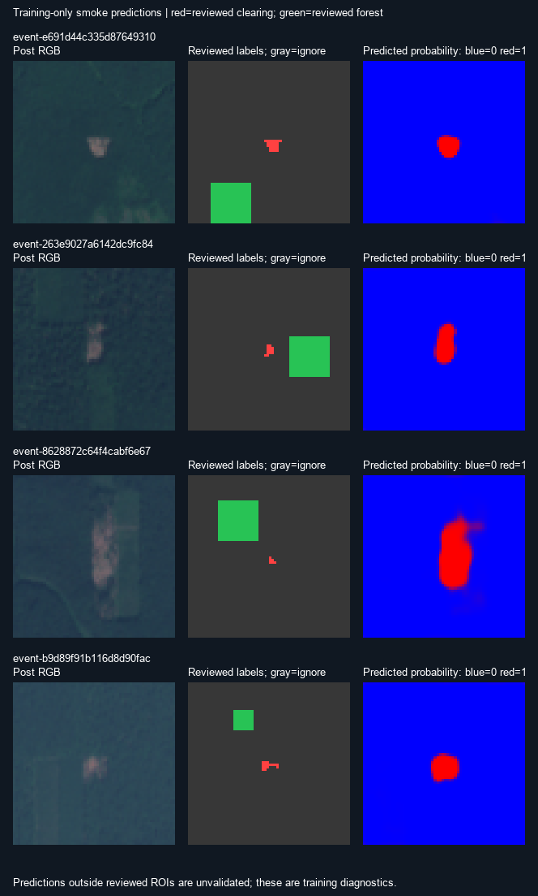
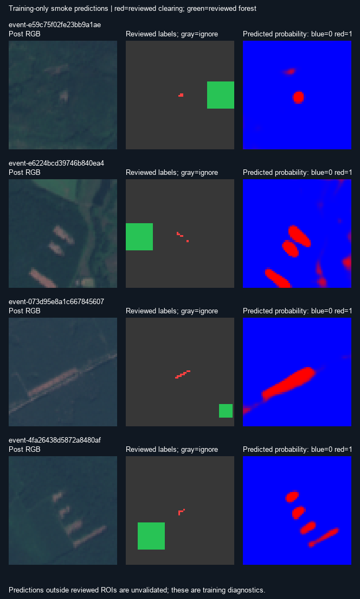
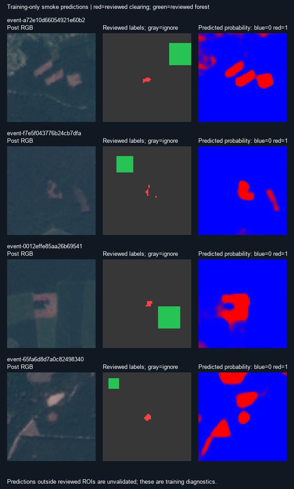
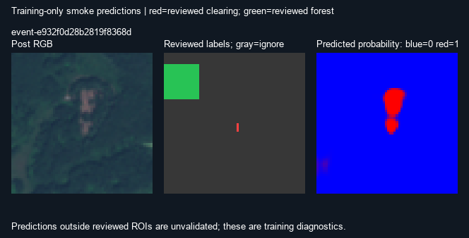

# All-13 reviewed-pixel training diagnostic

**Training data only. These scores do not estimate unseen-location accuracy.**

Completed 1664 fixed updates. Final fit on every reviewed example: **True**.

| Attempt | Pixel-weighted BCE | Normalized BCE | Dice | Precision | Recall | Specificity | Examples passing |
| ---: | ---: | ---: | ---: | ---: | ---: | ---: | ---: |
| 0 | 1.312841 | 0.693966 | 0.102651 | 0.054102 | 1.000000 | 0.000000 | 0/13 |
| 26 | 1.268606 | 0.670583 | 0.102651 | 0.054102 | 1.000000 | 0.000000 | 0/13 |
| 416 | 0.001754 | 0.000927 | 1.000000 | 1.000000 | 1.000000 | 1.000000 | 13/13 |
| 832 | 0.000727 | 0.000384 | 1.000000 | 1.000000 | 1.000000 | 1.000000 | 13/13 |
| 1664 | 0.000318 | 0.000168 | 1.000000 | 1.000000 | 1.000000 | 1.000000 | 13/13 |

## Final per-example reviewed scores

| Event | Clearing / forest | Dice | Precision | Recall | Specificity | Fit |
| --- | ---: | ---: | ---: | ---: | ---: | --- |
| event-e691d44c335d87649310 | 25 / 256 | 1.000000 | 1.000000 | 1.000000 | 1.000000 | True |
| event-263e9027a6142dc9fc84 | 13 / 256 | 1.000000 | 1.000000 | 1.000000 | 1.000000 | True |
| event-8628872c64f4cabf6e67 | 6 / 256 | 1.000000 | 1.000000 | 1.000000 | 1.000000 | True |
| event-b9d89f91b116d8d90fac | 16 / 64 | 1.000000 | 1.000000 | 1.000000 | 1.000000 | True |
| event-e59c75f02fe23bb9a1ae | 5 / 256 | 1.000000 | 1.000000 | 1.000000 | 1.000000 | True |
| event-e6224bcd39746b840ea4 | 6 / 256 | 1.000000 | 1.000000 | 1.000000 | 1.000000 | True |
| event-073d95e8a1c667845607 | 12 / 64 | 1.000000 | 1.000000 | 1.000000 | 1.000000 | True |
| event-4fa26438d5872a8480af | 6 / 256 | 1.000000 | 1.000000 | 1.000000 | 1.000000 | True |
| event-a72e10d66054921e60b2 | 15 / 256 | 1.000000 | 1.000000 | 1.000000 | 1.000000 | True |
| event-f7e5f043776b24cb7dfa | 10 / 144 | 1.000000 | 1.000000 | 1.000000 | 1.000000 | True |
| event-0012effe85aa26b69541 | 15 / 256 | 1.000000 | 1.000000 | 1.000000 | 1.000000 | True |
| event-65fa6d8d7a0c82498340 | 18 / 64 | 1.000000 | 1.000000 | 1.000000 | 1.000000 | True |
| event-e932f0d28b2819f8368d | 4 / 256 | 1.000000 | 1.000000 | 1.000000 | 1.000000 | True |

## Actual predictions

Gray label pixels are ignored; predictions there remain unvalidated.

The run changes normalization and exposure relative to the old 26-step smoke. It does not isolate an empirical cause.
All checkpoints and no-fit outcomes are retained. No early stopping, threshold tuning or held-out selection.
Gradient execution and saved-weight replay are worker receipts; the independent verifier reconstructs saved logits without executing a model.
